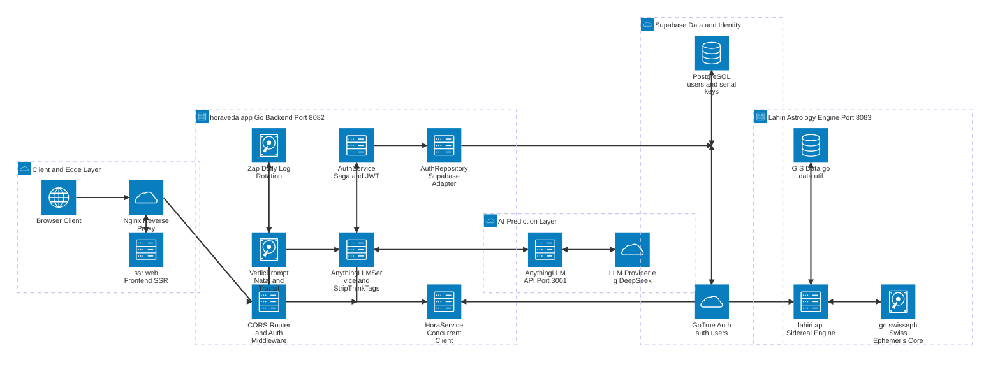

# สถาปัตยกรรมระบบระดับสูง (High-Level System Architecture) — Horaveda Ecosystem

เอกสารนี้อธิบายภาพรวมสถาปัตยกรรมระดับสูง (High-Level Architecture) ของบริการ **`horaveda-app`** (Go Backend API) และบริการอื่นๆ ที่ทำงานร่วมกันทั้งระบบ ตั้งแต่ฝั่งผู้ใช้งาน, Reverse Proxy / Frontend SSR, ฐานข้อมูลและระบบยืนยันตัวตน, เครื่องยนต์คำนวณดาราศาสตร์นิรายนะ Lahiri ไปจนถึงระบบพยากรณ์ด้วย AI (AnythingLLM / LLM)

> **วิธีแสดงผลแผนภาพ `architecture-beta`:** บล็อก Mermaid ด้านล่างใช้ Syntax ประเภท `architecture-beta` (รองรับบน **Mermaid v11.1.0+**, **GitHub**, หรือ **[mermaid.live](https://mermaid.live/)**) หากตัวอ่าน Markdown บางตัวไม่รองรับ `architecture-beta` สามารถคัดลอกโค้ดไปวางใน [https://mermaid.live/](https://mermaid.live/) เพื่อดูและส่งออกเป็นภาพได้ทันที

---

## 1. แผนภาพสถาปัตยกรรมระบบ (`mermaid architecture-beta`)



---

## 2. รายละเอียดบริการทั้งหมดในระบบ (Services & Boundaries)

### 2.1 Client & Edge Layer (ตามโครงสร้างใน [`SEQUENCE.md`](./SEQUENCE.md) และ `.env`)
| บริการ / องค์ประกอบ | บทบาทหน้าที่ | รายละเอียดการเชื่อมต่อ |
| :--- | :--- | :--- |
| **Browser Client** | ผู้ใช้งานปลายทางผ่านเว็บแอปพลิเคชัน | ใช้งานโดเมน `https://hora.garbagecollection.info` พร้อมเก็บ JWT ใน `HttpOnly Cookie` (`auth_token`) |
| **Nginx Reverse Proxy** | จุดรับทราฟฟิกหน้าด่าน (Reverse Proxy / TLS) | กระจายคำขอไปยัง `ssr-web` และ API ของ `horaveda-app` |
| **ssr-web (Frontend SSR)** | หน้าเว็บฝั่ง Frontend แบบ Server-Side Rendering | แสดงฟอร์มลงทะเบียน Serial Key, กรอกข้อมูลดวงชะตา, แสดงตารางดวงและคำทำนาย *(บริการภายนอกที่อ้างอิงใน `SEQUENCE.md`)* |

### 2.2 Core Service: `horaveda-app` (Go `1.24+`, Default `:8080` / `.env` `:8082`)
พัฒนาตามหลัก **Clean Architecture** ใน [`cmd/server/main.go`](./cmd/server/main.go) โดยฉีด Dependency จากชั้นนอกเข้าในและแยกความรับผิดชอบเป็นเลเยอร์ชัดเจน:

1. **HTTP Delivery Layer (`internal/delivery/http/`)**
   - [`CORSMiddleware`](./internal/delivery/http/middleware/cors.go): อนุญาต Origin (`CORS_ORIGIN`), `Access-Control-Allow-Credentials: true`, Headers (`Content-Type`, `Authorization`, `X-Admin-Key`) และ Preflight `OPTIONS`
   - [`NewRouter`](./internal/delivery/http/router.go): ใช้ `http.ServeMux` มาตรฐาน พร้อมตัวห่อ Log Request ทุกเส้นทาง
   - [`AuthMiddleware`](./internal/delivery/http/middleware/auth_middleware.go):
     - `RequireAuth`: ตรวจสอบ JWT (HS256) จาก Cookie `auth_token` หรือ Header `Authorization: Bearer`
     - `RequireAdminKey`: ตรวจสอบคีย์ผู้ดูแลระบบ (`X-Admin-Key` หรือ `Bearer`) ด้วย `subtle.ConstantTimeCompare`
   - **Handlers (`internal/delivery/http/handler/`)**:
     - Public: `POST /api/v1/auth/register-serial`, `POST /api/v1/auth/logout`, `GET|POST /api/v1/auth/serial-keys`
     - Protected (`RequireAuth`): `GET /api/v1/auth/verify`, `POST /api/v1/hora/predict` (`/prompt`), `POST /api/v1/hora/transitpredict`, `POST /api/v1/hora/transitpredict_1`–`_12` (ล็อก `transit_year=2027`, `transit_month=1..12`, `house_system="W"`)
     - Admin (`RequireAdminKey`): `POST|DELETE /api/v1/auth/revoke-user`

2. **Service / Usecase Layer (`internal/service/`)**
   - [`AuthService`](./internal/service/auth_service.go): ลงทะเบียนด้วย Serial Key พร้อม **Saga Rollback**, ถอนสิทธิ์ผู้ใช้บน Logout/Revoke, ออกและตรวจสอบ JWT Token (อายุ 24 ชม.)
   - [`HoraService`](./internal/service/hora_service.go): เรียกคำนวณดวงจาก `lahiri-api` (`:8083`) ด้วย HTTP Client Timeout `15s` และใช้ `GetBothPrompts` (`sync.WaitGroup`) ดึง Natal + Transit พร้อมกันแบบ **Concurrent**
   - [`VedicPrompt`](./internal/service/vedic_prompt.go): ประกอบ Prompt มาตรฐานโหราศาสตร์พระเวท (Vedic Jyotish — Lahiri / Whole Sign) ทั้ง [`BuildVedicPredictionPrompt`](./internal/service/vedic_prompt.go) และ [`BuildVedicTransitPredictionPrompt`](./internal/service/vedic_prompt.go)
   - [`AnythingLLMService`](./internal/service/anythingllm_service.go): บริหารความสัมพันธ์ **1 User : 1 Workspace : 1 Shared Thread** (`{username}-hora`), ป้องกันการสร้าง Workspace ซ้ำ, ลองสร้างใหม่อัตโนมัติเมื่อเจอ `404` (**Auto-Recovery**), และกรองแท็กความคิดของโมเดลออกด้วย [`StripThinkTags`](./internal/service/anythingllm_service.go)

3. **Repository & Shared Infrastructure (`internal/repository/`, `pkg/`)**
   - [`AuthRepository`](./internal/repository/auth_repository.go): เชื่อมต่อ Supabase PostgREST (`users`, `serial_keys`) และ GoTrue Admin API (`auth.users`)
   - [`Zap Daily Logger`](./pkg/logger/logger.go): บันทึกลง `logs/app-YYYY-MM-DD.log` และ `logs/app.log` หมุนเวียนทุกเที่ยงคืน (Midnight Watcher), คุมขนาดสูงสุด 100 MB/ไฟล์ (บีบอัด `.gz`) และลบไฟล์เก่าเกิน 28 วันอัตโนมัติ
   - [`pkg/response`](./pkg/response/response.go): มาตรฐาน JSON `{success, message, data}` และ `AppError`

### 2.3 Downstream / External Services ที่เกี่ยวข้อง

| บริการ | พอร์ต / Endpoint หลัก | หน้าที่การทำงานร่วมกับ `horaveda-app` |
| :--- | :--- | :--- |
| **Supabase (PostgreSQL & GoTrue Auth)** | HTTPS (`NEXT_PUBLIC_SUPABASE_URL`) | เก็บตาราง `public.users` และ `public.serial_keys` (พร้อมนิยาม SQL Transaction RPC ใน `migrations/`) และจัดการบัญชีผู้ใช้ใน `auth.users` ด้วยอีเมล `<username>@garbagecollection.info` |
| **Lahiri Horoscope Engine (`lahiri-api`)** | HTTP `:8083`<br/>• `/api/v1/hora/prompt`<br/>• `/api/v1/hora/transitdasha_prompt` | คำนวณตำแหน่งดาว, ลัคนา, นักษัตร, นวางศ์ D9 และวิมโศตรีทศา ตามระบบนิรายนะ Lahiri (`TimeZone=7.0`, `HouseSystem="W"`)<br/>*(ตาม [`SEQUENCE.md`](./SEQUENCE.md) ภายในทำงานร่วมกับ `go-data-util` สำหรับข้อมูล GIS/Timezone และ `go-swisseph` + `swisseph` C Core + ไฟล์ Ephemeris `ep4`/`sat`)* |
| **AnythingLLM Developer API** | HTTP `:3001/api/v1`<br/>• `/workspace/:slug`<br/>• `/workspace/new`<br/>• `/workspace/:slug/thread/new`<br/>• `/workspace/:slug/thread/:thread/chat` | จัดการบริบทสนทนาประจำตัวผู้ใช้ (1 Workspace : 1 Shared Thread) และส่ง Prompt ไปยัง **LLM Provider** (เช่น **DeepSeek**, Timeout สูงสุด `300s`) เพื่อสร้างคำทำนายภาษาไทย |

---

## 3. กระแสการทำงานสำคัญระหว่างบริการ (Key Cross-Service Flows)

### 3.1 การลงทะเบียน Serial Key และ Saga Rollback
```text
Client -> horaveda-app (HandleSerialRegister)
  1. ตรวจ Serial Key ใน Supabase DB (serial_keys.is_used == false)
  2. Insert ผู้ใช้ใหม่ใน public.users
  3. สร้างบัญชีใน Supabase GoTrue (auth.users) -> หากพัง Rollback (2)
  4. อัปเดต serial_keys (is_used=true, user_id) -> หากพัง Rollback (3), (2)
  5. ลงนาม JWT HS256 (24 ชม.) -> หากพัง Rollback (4), (3), (2)
  6. ตอบกลับ 200 OK พร้อม Set-Cookie: auth_token (HttpOnly)
```
*(เมื่อผู้ใช้ `logout` หรือแอดมินเรียก `revoke-user` ระบบจะปลดล็อก `serial_keys` กลับเป็น `is_used=false, user_id=null` และลบข้อมูลทั้ง `public.users` และ `auth.users`)*

### 3.2 การพยากรณ์พื้นดวงกำเนิด (`POST /api/v1/hora/predict` หรือ `/prompt`)
1. `AuthMiddleware.RequireAuth` ตรวจสอบ JWT และดึง `username`
2. `HoraService.GetHoraPrompt` ยิง `POST` ไปยัง `lahiri-api` (`:8083/api/v1/hora/prompt`) เพื่อรับพิกัดดาวกำเนิด
3. `AnythingLLMService.PredictNatalChart` นำพิกัดดาวมาประกอบเป็น Prompt ด้วย `BuildVedicPredictionPrompt`
4. ตรวจสอบ/สร้าง Workspace (`strings.ToLower(username)`) และ Thread (`{workspace}-hora`) บน AnythingLLM (`:3001`) พร้อมส่งแชทคำทำนาย (มี Retry อัตโนมัติถ้าเจอ `404`)
5. กรอง `<think>...</think>` ด้วย `StripThinkTags` แล้วคืนผล `{status, prompt, prediction, workspace_slug, thread_slug}`

### 3.3 การพยากรณ์ดาวจรรายเดือน (`POST /api/v1/hora/transitpredict` และ `transitpredict_1`–`_12`)
1. `HoraService.GetBothPrompts` ยิงคำขอ **พร้อมกันแบบ Concurrent** (`sync.WaitGroup`) ไปยัง `lahiri-api` ทั้ง `/prompt` (Natal) และ `/transitdasha_prompt` (Transit & Dasha)
2. `BuildVedicTransitPredictionPrompt` ผสานข้อมูลดาวกำเนิด + ดาวจร + เกณฑ์วิเคราะห์ดาวจรเร็ว/ช้า
3. `AnythingLLMService.PredictTransitChart` ส่ง Prompt เข้า **Thread เดิมร่วมกัน** (`{workspace}-hora`) เพื่อให้ AI อ้างอิงบริบทพื้นดวงต่อเนื่องได้
4. `StripThinkTags` ลบส่วน `<think>` ออก ก่อนส่งผลคำทำนายรายเดือนกลับไปยังหน้าเว็บ

### 3.4 กลไก Graceful Fallback และ Timeout
- **`AnythingLLMTimeout` = 300 วินาที** (`cmd/server/main.go` ตั้ง `HTTP WriteTimeout = AnythingLLMTimeout + 60s` = `360s`) เพื่อรองรับโมเดลขนาดใหญ่หรือ Reasoning LLM
- หาก AnythingLLM ไม่พร้อมใช้งาน, Timeout, หรือหลังตัด `<think>` แล้วไม่เหลือเนื้อหา: `horaveda-app` **ไม่โยน HTTP 502 กลับไปให้ Reverse Proxy/Cloudflare ตัดหน้า Error** แต่จะส่ง **HTTP `200 OK`** พร้อมพิกัดดวงดาวที่คำนวณเสร็จแล้วและฟิลด์ `warning` เพื่อให้ Frontend แสดงข้อมูลดวงได้ต่อเนื่อง
