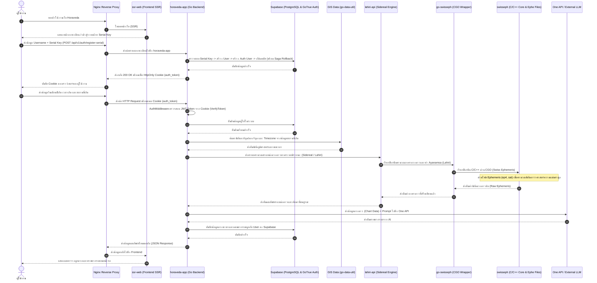
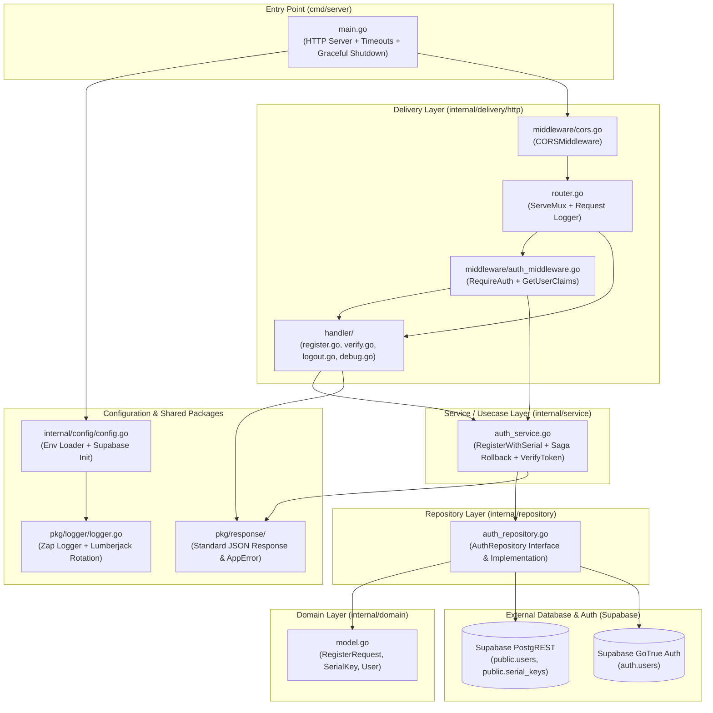

```mermaid
sequenceDiagram
    autonumber
    actor Client as ผู้ใช้งาน (Browser / Client)
    participant CORS as CORSMiddleware
    participant Router as HTTP Router (ServeMux)
    participant AuthMW as AuthMiddleware
    participant Handler as AuthHandler
    participant Service as AuthService
    participant Repo as AuthRepository
    participant SupaDB as Supabase DB (users / serial_keys)
    participant SupaAuth as Supabase GoTrue (auth.users)

    %% =========================================================================
    %% חלקที่ 1: CORS Preflight Request
    %% =========================================================================
    rect rgb(240, 248, 255)
        Note over Client,CORS: 0. การตรวจสอบ CORS Preflight (OPTIONS Request)
        Client->>CORS: OPTIONS /api/v1/auth/*
        CORS-->>Client: 200 OK (Set Access-Control-Allow-* Headers)
    end

    %% =========================================================================
    %% ส่วนที่ 2: การลงทะเบียนด้วย Serial Key พร้อมระบบ Saga Rollback
    %% =========================================================================
    rect rgb(235, 250, 235)
        Note over Client,SupaAuth: 1. การลงทะเบียนด้วย Serial Key (POST /api/v1/auth/register-serial)
        Client->>CORS: POST /api/v1/auth/register-serial {username, serial_key}
        CORS->>Router: ส่งต่อ Request พร้อมตั้งค่า CORS Headers
        Router->>Handler: บันทึก Log คำขอ และเรียก HandleSerialRegister()
        Handler->>Handler: ตรวจสอบ Method POST และตรวจสอบรูปแบบ Username (^[a-zA-Z0-9]+$)

        alt ข้อมูล Input ไม่ถูกต้อง
            Handler-->>Client: 400 Bad Request (JSON Error Response)
        else ข้อมูล Input ถูกต้อง
            Handler->>Service: RegisterWithSerial(username, serialKey)

            %% Step 1: ตรวจสอบ Serial Key
            Service->>Repo: FindSerialKey(serialKey)
            Repo->>SupaDB: SELECT * FROM serial_keys WHERE key_code = serialKey
            SupaDB-->>Repo: คืนข้อมูล Serial Key
            Repo-->>Service: คืน *domain.SerialKey

            alt ไม่พบ Serial Key หรือคีย์ถูกใช้งานไปแล้ว (IsUsed == true)
                Service-->>Handler: AppError (404 Not Found / 400 Bad Request)
                Handler-->>Client: 404 / 400 JSON Error Response
            else Serial Key พร้อมใช้งาน
                %% Step 2: สร้าง User ใน public.users
                Service->>Repo: CreateUser(username)
                Repo->>SupaDB: INSERT INTO users (username)
                SupaDB-->>Repo: คืนข้อมูล User ที่สร้างใหม่ (user.ID)
                Repo-->>Service: คืน *domain.User

                alt ชื่อผู้ใช้ซ้ำ (CreateUser ล้มเหลว)
                    Service-->>Handler: AppError (400 Bad Request: ชื่อผู้ใช้นี้ถูกใช้งานแล้ว)
                    Handler-->>Client: 400 Bad Request
                else สร้าง User ใน public.users สำเร็จ
                    %% Step 3: สร้าง User ใน Supabase Auth
                    Service->>Repo: CreateSupabaseAuthUser(email, serialKey, username)
                    Repo->>SupaAuth: POST /auth/v1/admin/users (AdminCreateUser)

                    alt สร้าง Supabase Auth User ล้มเหลว (Rollback ขั้นที่ 1)
                        SupaAuth-->>Repo: Error
                        Repo-->>Service: Error
                        Note over Service,SupaDB: ⚠️ Saga Rollback: ลบ User ที่เพิ่งสร้างใน public.users ทิ้ง
                        Service->>Repo: DeleteUser(user.ID)
                        Repo->>SupaDB: DELETE FROM users WHERE id = user.ID
                        Service-->>Handler: AppError (500 Internal Server Error)
                        Handler-->>Client: 500 Internal Server Error
                    else สร้าง Supabase Auth User สำเร็จ (ได้ authUserID)
                        SupaAuth-->>Repo: 200 OK (authUserID UUID)
                        Repo-->>Service: คืน authUserID

                        %% Step 4: อัปเดตสถานะ Serial Key
                        Service->>Repo: UpdateSerialKeyStatus(keyData.ID, user.ID)
                        Repo->>SupaDB: UPDATE serial_keys SET is_used=true, user_id=user.ID

                        alt อัปเดตสถานะ Serial Key ล้มเหลว (Rollback ขั้นที่ 2)
                            SupaDB-->>Repo: Error
                            Repo-->>Service: Error
                            Note over Service,SupaAuth: ⚠️ Saga Rollback: ลบทั้ง Supabase Auth User และ User ใน public.users
                            Service->>Repo: DeleteSupabaseAuthUser(authUserID)
                            Repo->>SupaAuth: DELETE /auth/v1/admin/users/{authUserID}
                            Service->>Repo: DeleteUser(user.ID)
                            Repo->>SupaDB: DELETE FROM users WHERE id = user.ID
                            Service-->>Handler: AppError (500 Internal Server Error)
                            Handler-->>Client: 500 Internal Server Error
                        else อัปเดตสถานะ Serial Key สำเร็จ
                            SupaDB-->>Repo: 200 OK
                            Repo-->>Service: nil (สำเร็จ)

                            %% Step 5: สร้าง JWT Token
                            Service->>Service: สร้างและลงนาม JWT Token (HS256, อายุ 24 ชม.)
                            alt สร้าง JWT Token ล้มเหลว (Rollback ขั้นที่ 3)
                                Note over Service,SupaAuth: ⚠️ Saga Rollback: คืนสถานะคีย์ + ลบ Auth User + ลบ User
                                Service->>Repo: RollbackSerialKeyStatus(keyData.ID)
                                Repo->>SupaDB: UPDATE serial_keys SET is_used=false, user_id=null
                                Service->>Repo: DeleteSupabaseAuthUser(authUserID)
                                Repo->>SupaAuth: DELETE /auth/v1/admin/users/{authUserID}
                                Service->>Repo: DeleteUser(user.ID)
                                Repo->>SupaDB: DELETE FROM users WHERE id = user.ID
                                Service-->>Handler: AppError (500 Internal Server Error)
                                Handler-->>Client: 500 Internal Server Error
                            else สร้าง JWT Token สำเร็จ
                                Service-->>Handler: คืนค่า signed JWT tokenString
                                Handler->>Handler: ตั้งค่า Cookie "auth_token" (HttpOnly, SameSite=Lax, Secure ตาม Config)
                                Handler-->>Client: 200 OK + Set-Cookie: auth_token (ลงทะเบียนสำเร็จ)
                            end
                        end
                    end
                end
            end
        end
    end

    %% =========================================================================
    %% ส่วนที่ 3: การตรวจสอบสิทธิ์ผู้ใช้งาน (Verify Auth)
    %% =========================================================================
    rect rgb(255, 248, 230)
        Note over Client,Service: 2. การตรวจสอบสถานะเข้าสู่ระบบ (GET /api/v1/auth/verify)
        Client->>CORS: GET /api/v1/auth/verify (แนบ Cookie: auth_token)
        CORS->>Router: ส่งต่อ Request
        Router->>AuthMW: RequireAuth(HandleVerifyAuth)
        AuthMW->>AuthMW: ดึง Cookie "auth_token"

        alt ไม่มี Cookie auth_token
            AuthMW-->>Client: 401 Unauthorized (กรุณาเข้าสู่ระบบก่อนใช้งาน)
        else มี Cookie auth_token
            AuthMW->>Service: VerifyToken(cookie.Value)
            Service->>Service: ตรวจสอบ Signature (HMAC-SHA256) และวันหมดอายุ (exp)

            alt Token ไม่ถูกต้องหรือหมดอายุ
                Service-->>AuthMW: AppError (401 Unauthorized)
                AuthMW-->>Client: 401 Unauthorized
            else Token ถูกต้อง
                Service-->>AuthMW: คืนค่า jwt.MapClaims
                AuthMW->>Handler: แนบ Claims ลง Context (UserClaimsKey) แล้วเรียก HandleVerifyAuth()
                Handler->>Handler: ดึง Claims ผ่าน middleware.GetUserClaims(r.Context())
                Handler-->>Client: 200 OK {success: true, message: "ตรวจสอบสิทธิ์สำเร็จ", data: {username}}
            end
        end
    end

    %% =========================================================================
    %% ส่วนที่ 4: การออกจากระบบ (Logout)
    %% =========================================================================
    rect rgb(253, 237, 236)
        Note over Client,Handler: 3. การออกจากระบบ (POST /api/v1/auth/logout)
        Client->>CORS: POST /api/v1/auth/logout
        CORS->>Router: ส่งต่อ Request
        Router->>Handler: เรียก HandleLogout()
        Handler->>Handler: ตั้งค่า Cookie "auth_token" เป็นค่าว่าง และ MaxAge = -1
        Handler-->>Client: 200 OK + Set-Cookie: auth_token="" (ออกจากระบบสำเร็จ)
    end
```

# แผนผังลำดับการทำงานของระบบ (Horaveda Sequence Diagrams สำหรับ Mermaid.live)

เอกสารนี้รวบรวมแผนผัง **Sequence Diagram** และ **Architecture Flowchart** ที่อธิบายการทำงานทั้งหมดของโปรเจกต์ `horaveda-app` โดยสามารถคัดลอกโค้ดในบล็อก `mermaid` ไปวางใน **[https://mermaid.live/](https://mermaid.live/)** เพื่อแสดงผลหรือส่งออกเป็นรูปภาพได้ทันที

---

## 1. Sequence Diagram: การทำงานภายใน `horaveda-app` (Clean Architecture & Saga Rollback)

แผนผังนี้แสดงลำดับการทำงานจริงของโค้ดในโปรเจกต์ `horaveda-app` ครบทุกเลเยอร์ (`Middleware` -> `Router` -> `Handler` -> `Service` -> `Repository` -> `Supabase`) รวมถึงกลไก **Saga Rollback / Compensation** เมื่อเกิดข้อผิดพลาดระหว่างการลงทะเบียน

> คัดลอกโค้ดด้านล่างนี้ไปวางที่ [https://mermaid.live/](https://mermaid.live/) ได้เลย

---

## 2. Sequence Diagram: ภาพรวมการทำงานทั้งระบบ Horaveda (End-to-End System Flow)

แผนผังนี้แสดงการทำงานตั้งแต่ผู้ใช้งานเข้าหน้าเว็บผ่าน Nginx / Frontend SSR, ยืนยันตัวตนกับ `horaveda-app`, คำนวณตำแหน่งดวงดาวผ่าน `lahiri-api` (Swiss Ephemeris) ไปจนถึงการส่งแปลผลคำพยากรณ์ด้วย AI (LLM)

> คัดลอกโค้ดด้านล่างนี้ไปวางที่ [https://mermaid.live/](https://mermaid.live/) ได้เลย

---

## 3. Flowchart: โครงสร้างสถาปัตยกรรม Clean Architecture ของ `horaveda-app`

> คัดลอกโค้ดด้านล่างนี้ไปวางที่ [https://mermaid.live/](https://mermaid.live/) ได้เลย

